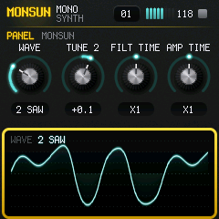
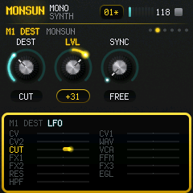
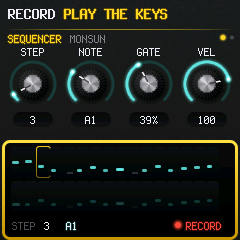
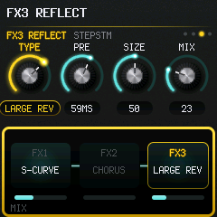

# MONSUN

A monophonic synth for the M-VAVE FM-1 by **swtdr34mz**, in the spirit of the Dreadbox Typhon.
On the screen, the look of its panel, refined: anodised anthracite, the name glowing yellow, knurled knobs with brushed
aluminium caps on glowing teal rings, and an OLED behind glass in its yellow frame, where the real output signal, the
filter curve and the envelopes move live. It opens with falling rain and a monsoon swirl.
Built on [fm1-base](https://github.com/charlesvestal/fm1-base) and [felucca-bsp](https://github.com/hugelton/felucca-bsp).

   

## The voice

Two oscillators, and one **WAVE** knob that fades through their combinations instead of switching: TRI, SAW, 2 SAW,
SAW+SQR, 2 SQR, PULSE, FM SOFT, FM HARD (in the last two VCO 2 frequency-modulates VCO 1; TUNE 2 sets the ratio).
**TUNE 2** is fine around the middle (a slow beat) and coarse towards the ends (a fifth, an octave, two).

The filter is a 24 dB **ladder low-pass** (after Antti Huovilainen), four saturating stages run at twice the sample
rate; it self-oscillates and tracks the keys. Two ADSRs, for the filter and the amp. **FILTER TIME** and **AMP TIME**
scale a whole envelope, up to 10 times slower or 6 times faster, as on the Typhon. Glide (always, or AUTO: only legato),
legato, VCF FFM (VCO 2's triangle into the cutoff), velocity to cutoff and level.

**STORM** (on ALGORITHM) is MONSUN's own: a detuned copy of each oscillator, a slow wander in the filter and a moving
side channel that widens the image. Turned fully up, the mono synth becomes a wall.

If the FM-1 runs short of time (the load over 88 % for a second), MONSUN drops the oversampling by itself and shows
**ECO**.

## The modulators

Three, M1 to M3, as on the Typhon: each has one source, and its own level to each of 13 destinations at once
(CV, CV1, CV2, WAV, CUT, VCA, FX1, FFM, FX2, FX3, RES, EGL, HPF). Pitch levels are fine around zero (vibrato) and
reach ±24 semitones.

| Mode | K2 | K3 | K4 |
| --- | --- | --- | --- |
| LFO | RATE | WAVE: TRI, SQUARE, PULSE 25, TRAPEZ, CHAOS SAW | FADE (+ in, - out, far left: one cycle) |
| ENV | A | D/R | S |
| RANDOM | RATE | LAG | PROB |
| STEP | # (1..16 steps) | STEP | ->LVL |

Their second page: **DEST** (choose a destination), **LVL** (its level), **SYNC** (FREE, KEY, BPM, BPM KEY).
The step modulator runs at the sequencer's division and starts over with each note you play.

## The effects

In the Typhon's order: a 2-pole **high-pass** (HP CUT on the filter page), then

- **FX1** HARD CLIP, FOLDBACK, S-CURVE, TRI CLIP, SHRED, BIT CRUSH: GAIN, LVL, MIX (for the crusher: RATE, BITS)
- **FX2** CHORUS, ENSEMBLE, FLANGER: DEPTH, SPD, MIX; WIDTH and FEED on FX MORE
- **FX3** DELAY (left and right times), PING PONG, LARGE REV, SOFT REV (PRE, SIZE): MIX; FEED and DAMP (- low-pass,
  + high-pass) on FX MORE. Delay times are free or in tempo (DLY SYNC), up to 1 s.

## The sequencer

32 steps, each with a **NOTE**, a **GATE** (far left REST, far right TIE: the note slides into the next step) and a
**VEL**; for the whole sequence **LENG**, **DVS** (steps per bar), **PROB** and **SWING**. While it runs, the keys
transpose it (C3 plays it as it is), as on the Typhon.

**RECORD**: on a SEQ page press REC, then play: each key writes the selected step and moves on; past the end the
sequence grows (APPEND), up to 32. REC again, or leaving the SEQ pages, ends it. **ARP** on a SEQ page copies a step,
and pastes it on the next press.

MONSUN follows **MIDI clock and START / STOP / CONTINUE** over USB; MIDI notes play it (and transpose a running
sequence), pitch bend bends it.

## Pages

| Button | Page | K1 | K2 | K3 | K4 |
| --- | --- | --- | --- | --- | --- |
| HOME | **PANEL** | WAVE | TUNE 2 | FILTER TIME | AMP TIME |
| SEL | **FILTER** | CUTOFF | RESON | EG LEVEL | HP CUT |
| ENV | **FILTER EG** (ENV again: **AMP EG**) | ATTACK | DECAY | SUSTAIN | RELEASE |
| LFO | **M1**, **M1 DEST**, **M2**, **M2 DEST**, **M3**, **M3 DEST** | MODE / DEST | (by mode) / LVL | (by mode) / SYNC | (by mode) |
| EDIT | **SET** | GLIDE | VCO LVL | VCF TRACK | VCF FFM |
| EDIT again | **SET 2** | VCA LVL | LEGATO | GLIDE MODE | HP RES |
| FX | **FX1**, **FX2**, **FX3**, **FX MORE** | TYPE | | | MIX |
| GLO | **GLOBAL** | TEMPO | VEL>CUT | VEL>VCA | DLY SYNC |
| GLO again | **SETTINGS** | BEND (semitones) | MIDI CH | VELOCITY (on / fixed) | |
| SEQ | **SEQUENCER** | STEP | NOTE | GATE | VEL |
| SEQ again | **SEQ SETUP** | LENG | DVS | PROB | SWING |

## Controls

| Control | What it does |
| --- | --- |
| SELECT | CUTOFF, on every page |
| ALGORITHM | STORM |
| PRESET | The 16 preset slots (loads at once; changes not saved are left behind, as on the Typhon) |
| SAVE | Save: PRESET picks the slot, SAVE again saves (any other button cancels) |
| REC held 1 s | The slot's factory preset back (save it to keep it) |
| ARP | HOLD: notes keep sounding after the keys are let go |
| OCT- / OCT+ | The keys' octave |
| PLAY | The sequencer: start / stop |

Presets: MONSUN, DARKSUB, ACIDRN, FMBELLS, TYPHOON, WETSEAS, THUNDER, HYDRO, SQUELCH, RAINDRP, CYCLONE, LOWPRES,
BRASS, STEPSTM, CRUSHED, EYESTRM. The sound you are working on saves itself once the sequencer stops; the slots only
with SAVE.

## The sound core

`dsp/` is plain C with no tie to the FM-1, so the same files can go into a VST3 plugin. To hear it on a computer:

    cc -O2 -Idsp dsp/monsun_core.c tools/render_demo.c -lm -o render_demo && ./render_demo .

`tools/knobcheck.c` turns every parameter from one end to the other and measures what changes.

## Building

    git clone --recursive https://github.com/swtdr34mz-afk/MONSUN
    X0X_FONTSET=terminus python3 fm1-base/tools/build.py . --host
    build/host/monsun_host tests/basic.txt build/host

GitHub Actions builds the installable `.fwsc` on every push (Actions tab > the run > Artifacts). A tag `v0.1.0` makes a
release with it.

## Licence

MPL-2.0. See [CREDITS.md](CREDITS.md). Unofficial: MONSUN is not made by or connected with Dreadbox.
